# Three Seas

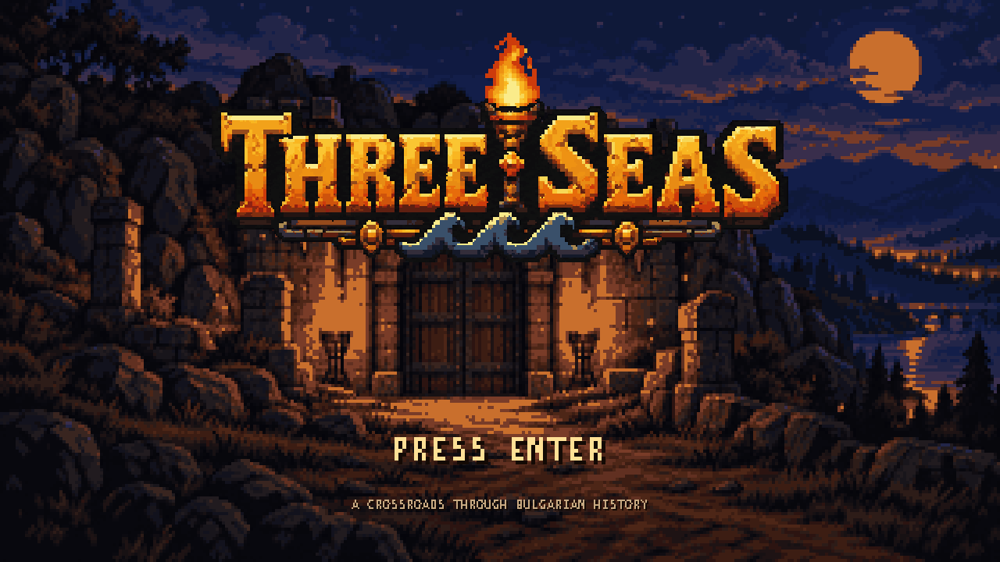

A dark dungeon maze game set in Bulgarian history. Every maze is a real historical place. You carry a torch that slowly burns down, and you only see what it lights. Find the exit before the flame dies.

> **Status:** version 1.0. The campaign (9 mazes in 3 eras), multiplayer for 2 to 4 players, the leaderboard, sounds and 24 QA tests are finished.

## Screenshots

| | |
|---|---|
| 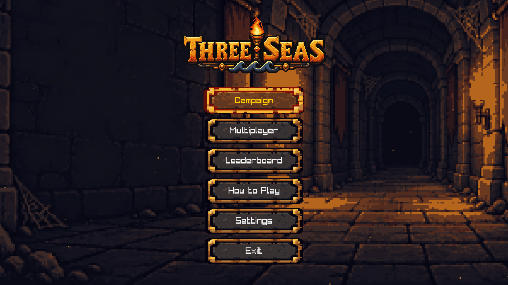 | 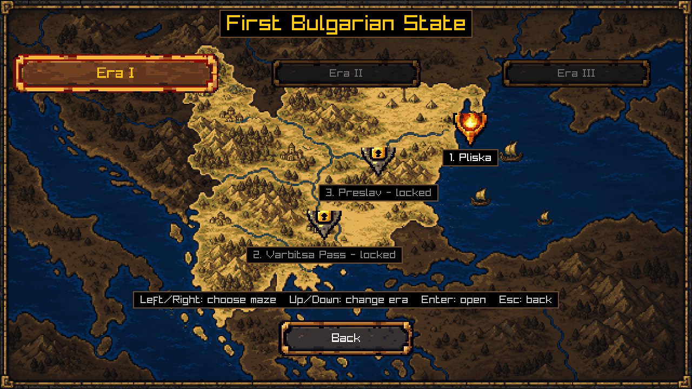 |
| Main menu | Campaign map with the three eras |
| 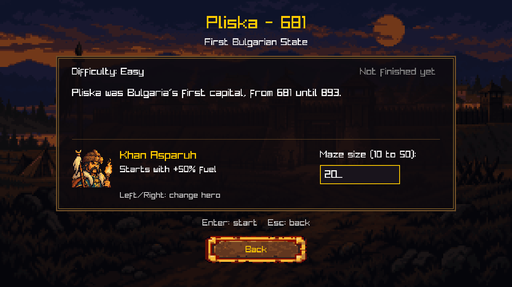 | 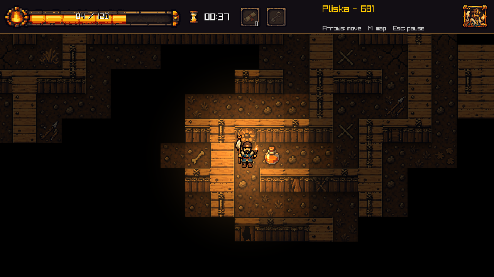 |
| Level intro with a fun fact | Pliska: torchlight, memory and fog |
| 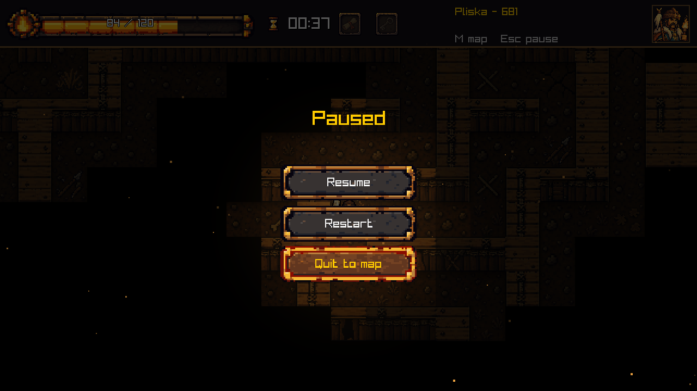 | 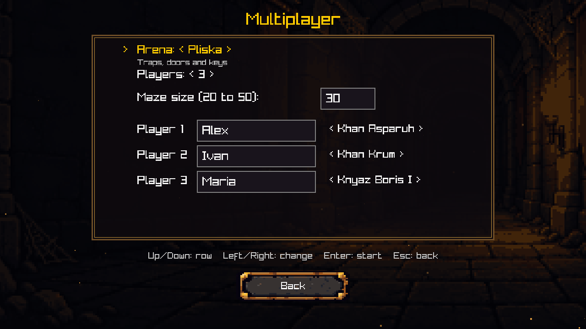 |
| Pause menu | Multiplayer setup |
| 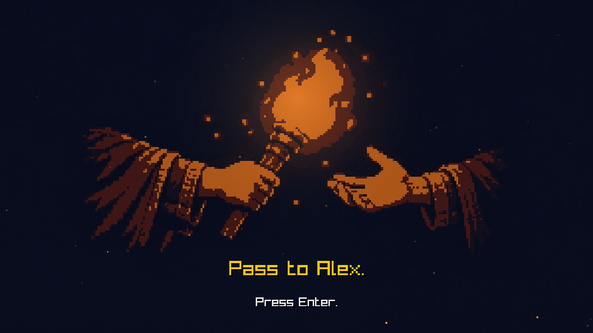 | 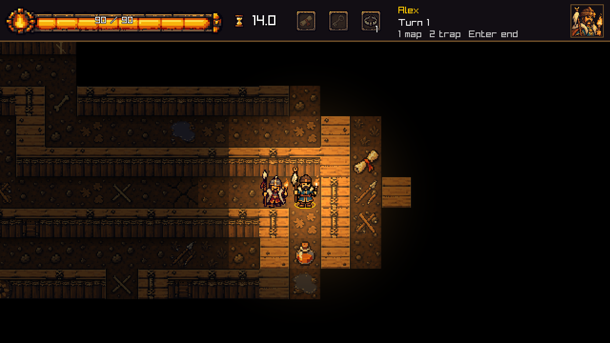 |
| Pass the torch to the next player | Multiplayer: another hero in your torchlight |
| 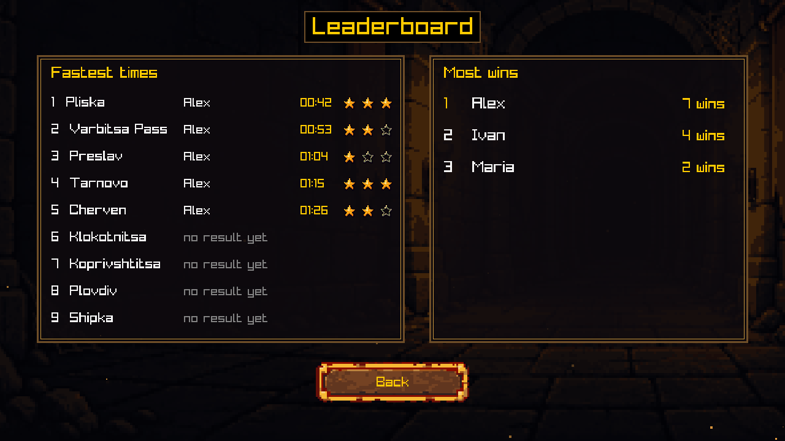 | 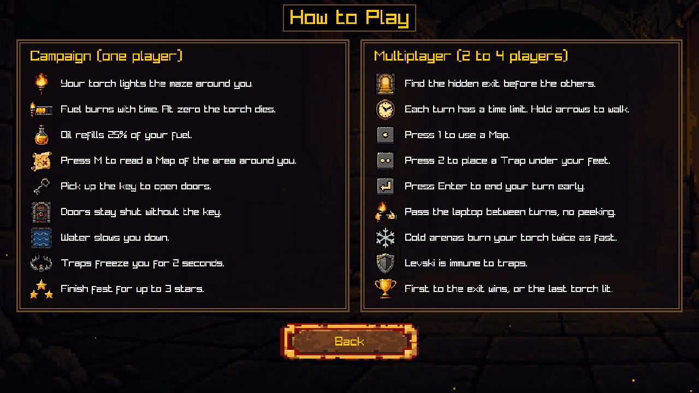 |
| Leaderboard | How to play |
| 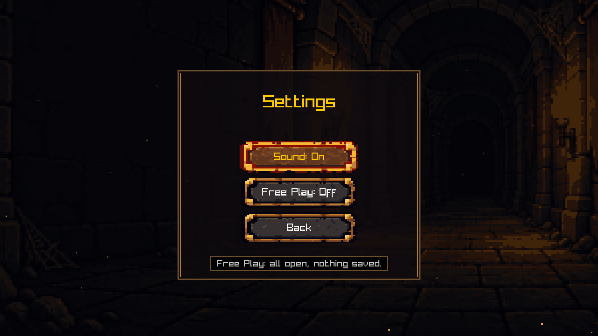 | |
| Settings | |

## How to play

### Campaign (1 player)

Nine mazes in three eras. Get from the top-left corner to the exit in the bottom-right corner before your torch goes out. Faster means more stars. Finishing a maze unlocks the next one.

- The torch burns 1 fuel every 2 seconds (twice as fast in cold places). Less fuel means a smaller circle of light.
- Places you have already seen stay dim on screen. Places you have never seen are black.
- You choose the maze size (10 to 50) before each level.

| Fuel left | What you see |
|---|---|
| more than 60% | 3 cells |
| 30% to 60% | 2 cells |
| less than 30% | 1 cell, and the screen flickers |
| 0 | torch out, restart the maze |

### Multiplayer (2 to 4 players, pass the laptop)

Every player starts in their own corner of one big maze. The exit is hidden in a room far from all corners, so you have to find it. Each player sees only their own torchlight, and other players show up when they are inside your light.

- Each turn has a time limit: 12 seconds on a size 20 maze, 18 on size 50, and one second less after every full round (never less than half).
- Hold the arrow keys to walk. The turn ends when the time is over, when you press Enter, or when you step on a trap.
- Press 1 to use a Map, or 2 to place a Trap on your cell. Others cannot see your trap.
- A black screen says who is next. The first player to reach the exit wins, or the last torch still burning.
- Each hero can be picked once per game, and mazes are 20 to 50 cells.

### Controls

| Key | Action |
|---|---|
| Arrow keys | Move (hold to keep walking) |
| M | Use a Map item |
| 1 / 2 | Multiplayer: Map / Trap |
| Enter | Confirm, or end your turn early |
| Esc | Pause menu / back |
| Mouse | Menus and buttons |

### Items and tiles

| Item | Effect |
|---|---|
| Oil | Refills 25% of the maximum fuel |
| Map | Reveals 4 cells around you (press M) |
| Key | Opens every locked door in the maze |

| Tile | Meaning |
|---|---|
| Floor / Wall | Walkable / not walkable |
| Locked door | A shortcut through a wall. You never need it to finish |
| Water | Walkable at half speed |
| Hidden trap | Visible only when you are next to it. Stepping on it holds you for 2 seconds |
| Exit | Campaign: bottom-right corner. Multiplayer: a hidden room |

## Heroes

Every hero has one power that is always on, in both game modes.

| Hero | Era | Power |
|---|---|---|
| Khan Asparuh | I | Starts with +50% fuel |
| Khan Krum | I | Sees all traps |
| Knyaz Boris I | I | Torch radius +1 |
| Tsar Simeon | I | Maps reveal double the area |
| Tsar Ivan Asen II | II | Opens doors without a key |
| Vasil Levski | III | Immune to traps |

## Eras and levels

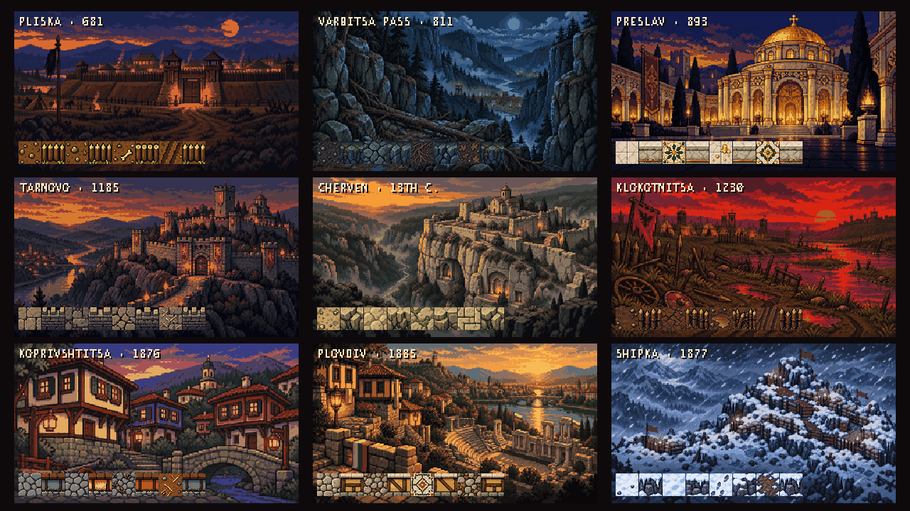

| Era | Years | New mechanic | Mazes |
|---|---|---|---|
| I. First Bulgarian State | 681-1018 | Traps, doors | Pliska, Varbitsa Pass, Preslav |
| II. Second Bulgarian State | 1185-1396 | Water | Tarnovo, Cherven, Klokotnitsa |
| III. Road to Liberation | 1870s-1885 | Cold | Koprivshtitsa, Plovdiv, Shipka |

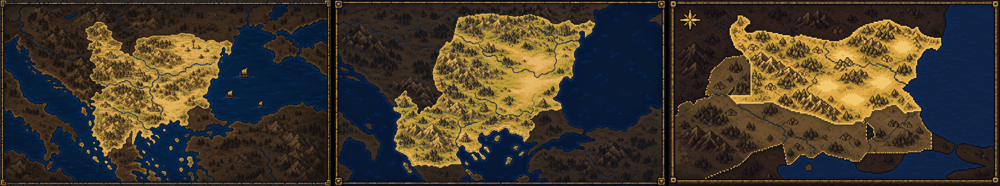

Each level shows one short, checked historical fact on its intro screen.

## Build

Requires CMake 3.20+ and a C++17 compiler. raylib 6.0 is downloaded automatically.

macOS / Linux:

```bash
cmake -S . -B build -DCMAKE_BUILD_TYPE=Release
cmake --build build
./build/crossroads
```

Windows (Visual Studio developer prompt):

```bat
cmake -S . -B build
cmake --build build --config Release
build\Release\crossroads.exe
```

Run the tests (they need no window):

```bash
ctest --test-dir build --output-on-failure
```

## Project structure

```
crossroads/
├── .github/
│   ├── ISSUE_TEMPLATE/           task and bug templates
│   ├── pull_request_template.md  checklist for every PR
│   └── CODEOWNERS
├── art/                          finished pixel art (UI, maps, levels, items, characters, effects, screens)
├── assets/                       textures, sounds, fonts, maps used by the game
├── docs/                         screenshots, technical documentation, QA documentation
├── src/
│   ├── main.cpp                  window and main loop
│   ├── types.h                   enums and structs
│   ├── maze.h / .cpp             create, generate, destroy the maze
│   ├── game.h / .cpp             movement, fuel, items, turns, winning
│   ├── levels.h / .cpp           9 levels, 3 arenas, 6 heroes
│   ├── validation.h / .cpp       checking user input
│   ├── save.h / .cpp             leaderboard and settings files
│   ├── render.h / .cpp           drawing the maze, light, HUD
│   ├── screens.h / .cpp          menus and all other screens
│   └── audio.h / .cpp            loading and playing sounds
├── tests/tests.cpp               QA test functions
├── .gitignore
├── CMakeLists.txt
└── README.md
```

The game logic (`maze`, `game`, `levels`, `validation`, `save`) never uses `cin`, `cout` or raylib. Only `render`, `screens` and `audio` draw, read keys or play sounds.

## Roadmap

| Sprint | Dates | Goal |
|---|---|---|
| 0 | 17-20 Oct | Everything ready to start |
| 1 | 21-25 Oct | Walk through a random maze |
| 2 | 26 Oct - 1 Nov | Era I playable from menu to result |
| 3 | 2-8 Nov | Feature complete |
| 4 | 9-15 Nov | Polish, documents, release v1.0 |

## Team

| Member | Role |
|---|---|
| Aleksandar Dyanov | Scrum Master + Frontend: headers, maze, drawing, art, reviews |
| Aleksandar Petrov | QA + Backend: tests, QA documentation, save files |
| Presiyan Tenev | Frontend: screens, HUD, sound |
| Loris Zadikyan | Backend: game rules, levels, input validation |

A school project ("Labyrinth", C++, 2026).

## Credits

- Pixel art generated with ChatGPT and post-processed with Python.
- Graphics and input: [raylib](https://www.raylib.com/) (zlib license).
- Sounds: 10 sound effects generated for this project (CC0, public domain). Font: raylib default font.
